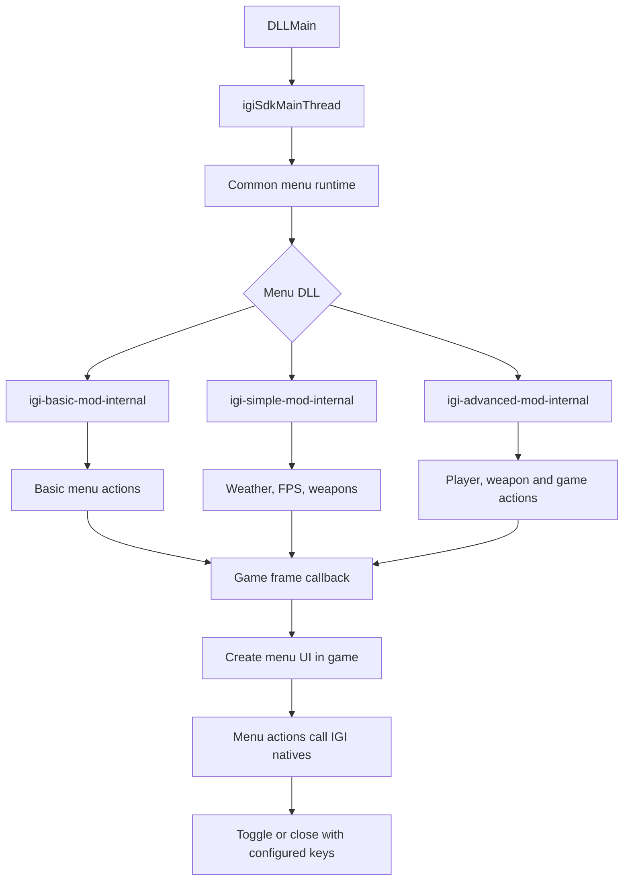

# Project IGI Mod Base

Version: 0.1

Project IGI Mod Base is a C++ foundation for creating single-player mods and in-game mod menus for Project I.G.I. It provides an in-game menu interface, game native bindings, runtime hooking and memory support, logging, and examples to build on.

The internal in-game menu is implemented. An external DirectX 7/ImGui interface is planned; it is not yet a finished GUI.

## Included mod menus


### Simple Mod Menu

- Rain state toggle and frame-rate selection (30, 60, or 120 FPS)
- Weapon list and pickup for Glock 17, MP5SD, UZI, M16A2, AK-47, Dragunov SVD, Minimi, and Spas 12
- First-person or third-person camera view
- Level selection for levels 1–14
- SFX volume, screen-flash clearing, and engine performance logging


### Advanced Mod Menu

- Everything in Simple Mod Menu
- Unlimited ammo
- Music volume control
- Player team/alive-state display
- Display refresh command

All controls run through the game-thread menu runtime. The mod menu pauses the
game while open and restores input when it closes.

Target: the EU/Chinese Windows x86 IGI 1 executable. Native Windows is
supported directly. On macOS and Linux, run the same Windows x86 game and DLL
through Wine using the included Wine scripts.
Out of scope: multiplayer, trainers, memory editors, process scanners.

## Requirements

- CMake 3.20+
- A 32-bit mingw-w64 toolchain (`i686-w64-mingw32-g++`), or a 32-bit MSVC toolset
- Python 3 (used to regenerate the hash table at build time)

The `data/` directory is local-only and ignored by Git. Builds use the checked-in native bindings when it is absent; regenerating bindings and running catalogue comparison tests requires the local IGI data files.

## Build

Everything is built by `tools/build-win32-dll.sh`. It sets the C, C++ and RC
cross-compilers explicitly and discards any stale build tree that still points
at a host compiler.

## C++ style and linting

Format all first-party C++ under `src/` and `demos/`:

```sh
python3 tools/format_cpp.py
python3 tools/format_cpp.py --check
```

Configure once with a compilation database, then run the static analyzer:

```sh
cmake -S . -B build-macos-verify -DCMAKE_EXPORT_COMPILE_COMMANDS=ON
cmake --build build-macos-verify --target lint_cpp format_cpp_check
```

GitHub Actions runs both checks on every pushed commit and pull request.

### Internal menu

```sh
# The mod menu DLL (default target)
tools/build-win32-dll.sh --release

# The injector and the keypress helper
tools/build-win32-dll.sh --release --target igi_injector
tools/build-win32-dll.sh --release --target igi_keypress
```

Build the simple menu demo:

```sh
tools/build-win32-dll.sh --debug --target igi_simple_mod_menu
```

Outputs land in `build-win32-release/` (`build-win32-debug/` with `--debug`):

| Artifact                       | Role                                                |
| ------------------------------ | --------------------------------------------------- |
| `igi-basic-mod-internal.dll` | The mod menu                                        |
| `IGI-Injector.exe`            | Loads the DLL into a running `igi.exe`              |
| `IGI-Keypress.exe`            | Sends keys to the Wine/Windows desktop during tests |

Debug builds allocate a console; Release builds log to file only.

## Natives

All wrappers live in `src/natives/mvp_natives.hpp` and use the
upstream `IGI::DOMAIN::NAME` style. Include the umbrella header and call them:

```cpp
#include "natives/mvp_natives.hpp"

const char weatherOn[] = {'r', 1, '\0'};
IGI::GAME::SET_RAINING(weatherOn);      // verified flag: weather[1] is 0 or 1
IGI::MISC::FRAMES_SET(30);             // frame limit
IGI::PLAYER::SET_UNLIMITED_AMMO();     // player
IGI::AUDIO::MUSIC_SET_VOLUME(0.5f, 1.0f);
IGI::GAME::SET_DISPLAY_MODE();

const bool paused = IGI::GAME::IS_PAUSED() != 0;
const auto event0 = IGI::GAME::GET_EVENT0();
void* world       = IGI::GAME::GET_WORLD();
```

Void natives are queued onto the game thread. Value-returning natives must be
called from the game thread, otherwise they log a warning and return zero.
The full symbol table is also available as `IGI::HASH::<Name>` constants.

## Menu helpers

[`demos/internal/helpers/menu_helpers.hpp`](demos/internal/helpers/menu_helpers.hpp)
contains optional wrappers for menu actions that need more than one native or
need consistent menu-side behavior, such as weather, frame rate, level loading,
and menu commands. Use these helpers when a menu needs one of those actions;
otherwise call typed `IGI::` natives directly. Add or extend a helper only when
the action is shared or requires a verified native call chain.

`requireLiveGameThread(runtime)` is the common guard for immediate in-level
actions. `refreshLiveMenu(runtime, effect)` uses the verified
`MenuManager_Refresh` native after an action, so the active menu redraws
without restarting the level. Weather, weapon pickup, player actions, audio,
and other verified native calls take effect on the next game frame and do not
reload a level. Level loading is intentionally separate: it detaches the
injected menu before the game destroys the old level. AI or building
creation/removal needs a verified object-specific native lifecycle; do not use
raw task memory or a generic task deletion helper for it.

`GAME::SET_RAINING` only changes the game's `gRaining` state. A level's own
`RainEffect` task owns visible precipitation; there is no verified global
native for creating, deleting, or converting that level-owned task into snow.

## Config

`project-igi-mod-config.ini` sits beside `igi.exe` and is read on startup.

```ini
[mod_menu]
enabled=true
start_key=F3              ; opens the menu and toggles it closed again
end_key=F12               ; closes the menu and unloads the SDK
native_mode=hooked        ; required for internal menus
screen_id=990
x=95
y=185
width=755
height=500
hook=display_add_frame_callback
log_level=debug           ; trace|debug|info|warning|error|critical
log_file=project-igi-mod.log
console=true
```

`start_key` and `end_key` accept `F3`–`F12`, `Home`, `End`, `PageUp`,
`PageDown`, `Insert` and `Delete`. The DLL, the injector and the scripts all
read these keys from this file; nothing hardcodes a hotkey.

The end key safely closes the menu, stops its hooks and stops the resident DLL
host thread. The DLL stays mapped until `igi.exe` exits to avoid calling
unloaded code, and the start key is disabled for the remainder of that process.

Each menu DLL owns its items in C++; `[mod_menu.items]` is not read.
Set `log_file` under `[mod_menu]` to a filename beside `igi.exe`; both Debug and Release builds use it. Directory paths are not accepted.

## Create, build and run a menu

Use `demos/internal/simple-mod/simple_menu.cpp` as the menu template. Edit its items
and typed `IGI::` native actions, then build `igi_simple_mod_menu`.

On native Windows, launch `igi.exe` normally and inject the built DLL with
`IGI-Injector.exe`. On macOS/Linux, use the Wine workflow below.

On macOS/Linux, set the Wine paths once. Copy the SDK config next to `igi.exe`;
its `start_key` toggles the menu and its `end_key` closes the menu and stops
its hooks. The DLL remains mapped until `igi.exe` exits so the game never jumps
to unloaded injected code; press the start key again to initialize the menu.

```sh
export IGI_GAME_DIR=/path/to/IGI
export IGI_WINEPREFIX=/path/to/wine-prefix
export WINE_BIN=/path/to/wine
cp config/project-igi-mod-config.ini "$IGI_GAME_DIR/project-igi-mod-config.ini"
```

Build and check the exact menu source and DLL:

```sh
tools/build-win32-dll.sh --debug --target igi_simple_mod_menu
IGI_RE_ROOT=/path/to/IGI-RE python3 tools/igi_runtime_harness.py \
  --path demos/internal/simple-mod/simple_menu.cpp --exe "$IGI_GAME_DIR/igi.exe" \
  --dll build-win32-debug/igi-simple-mod-internal.dll
```

Launch, inject and open the menu automatically:

```sh
python3 tools/run_igi_wine.py level9 build-win32-debug/igi-simple-mod-internal.dll \
  --attempts 10 --press-menu-key
```

The launcher sends Escape, injects the DLL, presses the configured start key,
and stops on its first successful injection. It retries failed launches up to
`--attempts`. Logs are in `/private/tmp/igi-live-validation/` and
`$IGI_GAME_DIR/project-igi-mod.log` (or the filename set by `log_file`).

For an already-running game, inject without launching a new level:

```sh
WINEPREFIX="$IGI_WINEPREFIX" tools/wine_igi_inject.sh \
  build-win32-debug/igi-simple-mod-internal.dll igi.exe
```

## Verification

Before injecting a mod menu, run the Unicorn x86 emulator with the source and
the exact DLL you built:

```sh
IGI_RE_ROOT=/path/to/IGI-RE python3 tools/igi_runtime_harness.py --path demos/internal/simple-mod/simple_menu.cpp --exe /path/to/igi.exe --dll build-win32-debug/igi-simple-mod-internal.dll
```

The scan maps `IGI::DOMAIN::NAME` calls to their declared native signatures and
retail addresses, then executes supported calls in synthetic emulator state.
Pickup uses an initialized player fixture with the weapon creation and sound
calls stubbed and checked. `DEFER` means a call needs live game state and was
not executed. Raw address calls are not found by the scanner. A passing scan
does not prove DLL initialization, menu rendering, actual game effects, or
that every signature is correct; test those in a running game as well.

```sh
tools/verify_igi_re_hook_source.sh /path/to/IGI-RE
tools/verify_igi_hook.sh /path/to/igi.exe
```

The first validates the local registration evidence; the second checks
the supported executable hash, hook prologues, calling convention metadata and
task-table references. The injected DLL repeats the two hook-prologue checks in
memory and does not run CryptoAPI file hashing inside Wine. `python3 tools/build_inject_mod.py --attempts N` builds,
launches the game under Wine, injects the DLL, presses the configured keys and
reports whether the menu attached.

## Menu execution flow

All three menu DLLs start through the same Windows entry point. They then select
their own menu implementation.



`igiSdkMainThread` handles configuration, hotkeys and shutdown. The shared
runtime creates the visible UI from the game frame callback; each DLL only
provides its own menu items and actions.

### Creating a new menu

The shared `src/mod_base/menu_host.cpp` calls these two functions:

```cpp
bool configureModMenu(igi::MenuConfig& config);
void runModMenu(const igi::MenuConfig& config,
                       igi::Runtime& runtime,
                       std::size_t item,
                       std::string_view value);
```

To create a new menu, implement both functions in your menu source file and
link that file with `src/mod_base/menu_host.cpp` and `src/platform/windows_dll.cpp`.

`configureModMenu()` defines the menu items and values. The shared runtime
calls it during `IGI_MenuManager_Internal_Initialize()`.

`runModMenu()` handles the selected item. The shared
`MenuScriptBridge` calls it whenever the player changes a menu value or invokes
an action.

The existing implementations are:

```text
igi-basic-mod-internal    → basic_menu.cpp    → basicMenuAction
igi-simple-mod-internal   → simple_menu.cpp   → simpleMenuAction
igi-advanced-mod-internal → advanced_menu.cpp → simple and advanced actions
```

Your new menu should follow the same two-function pattern as
`demos/internal/simple-mod/simple_menu.cpp` or `demos/internal/basic-mod/basic_menu.cpp`.

## License and credits

Read [`CREDITS.md`](CREDITS.md), [`NOTICE`](NOTICE) and `LICENSES/` before
redistributing. Metadata is attributed and kept as address/signature
research only.

- SlickDaddy and BlanknameEs — Project I.G.I. native research and information
- Artiom — QVM tools and compiler work
