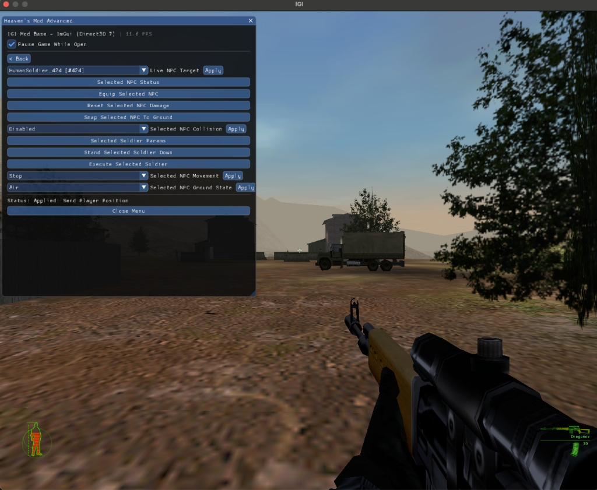
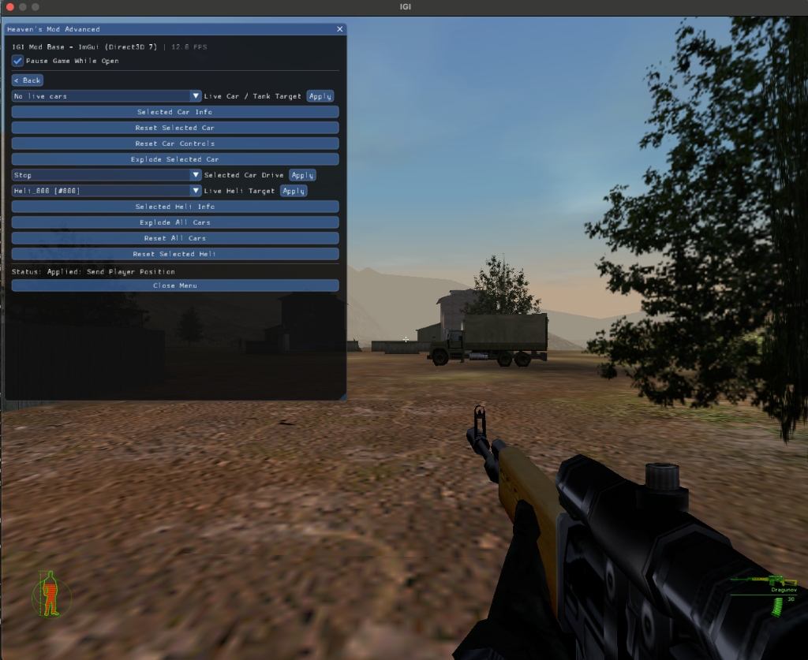
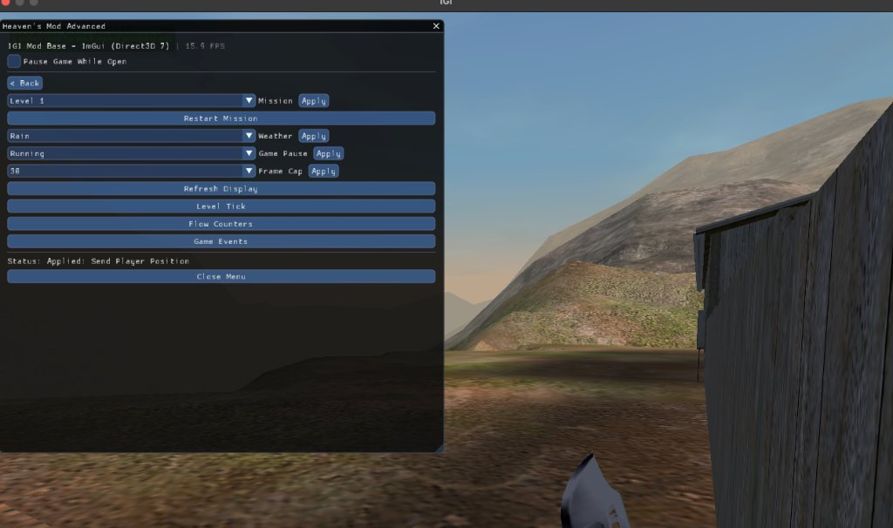
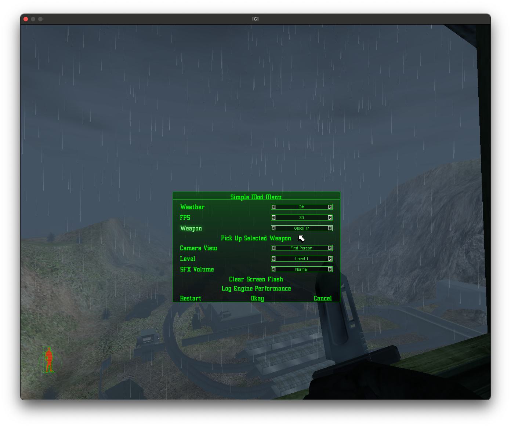
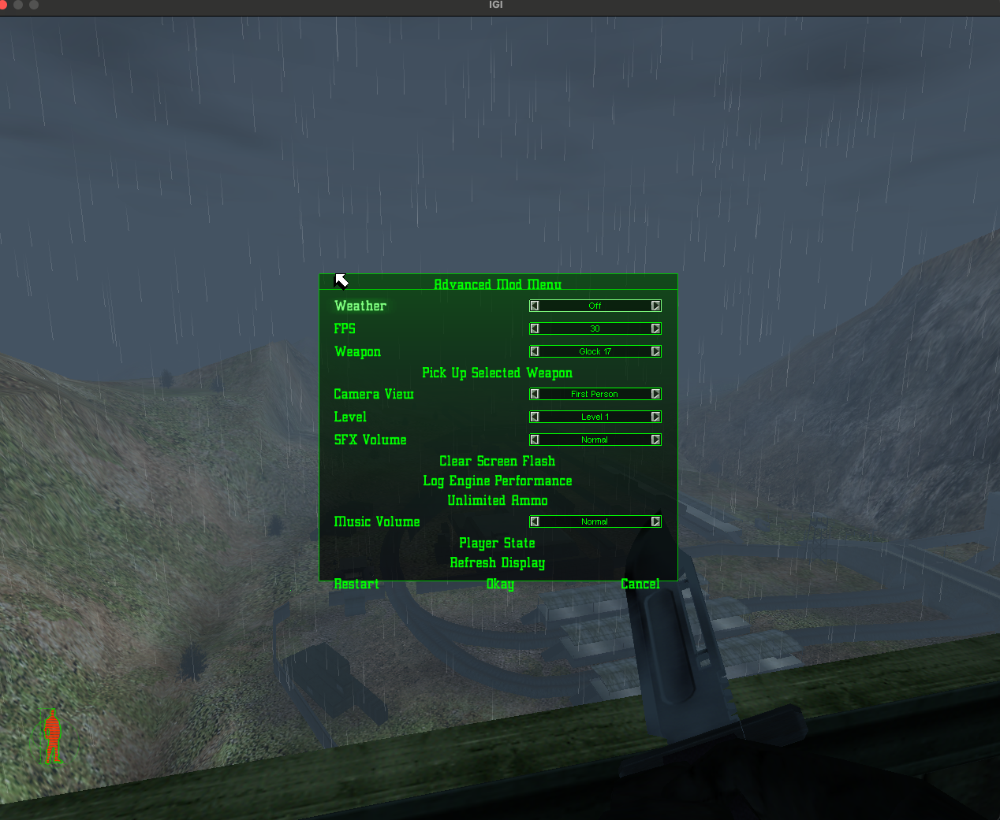
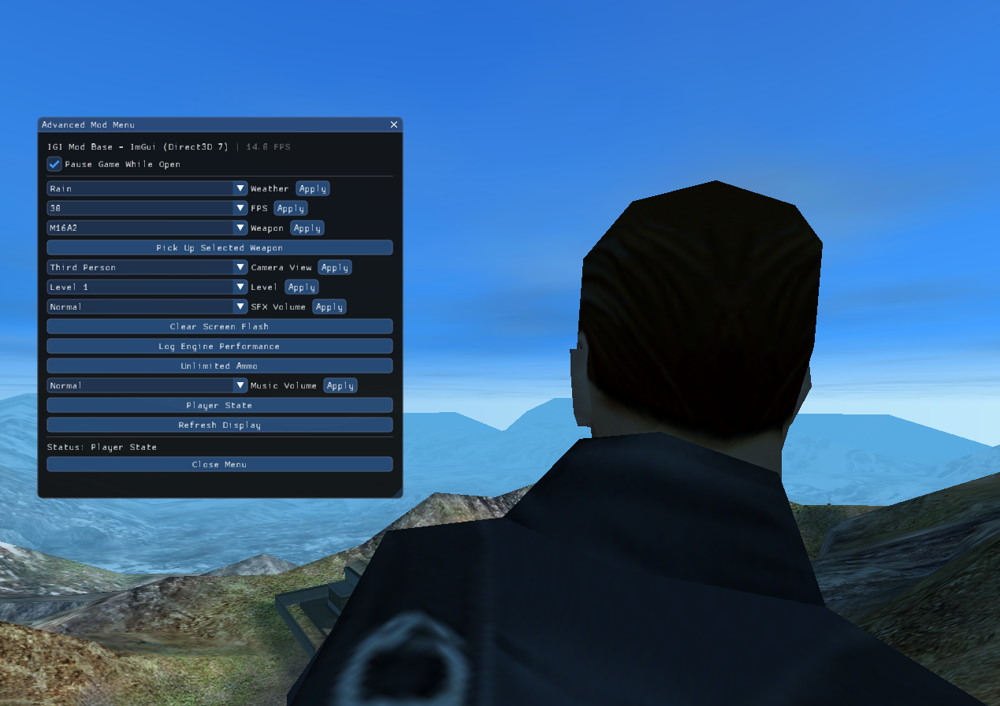
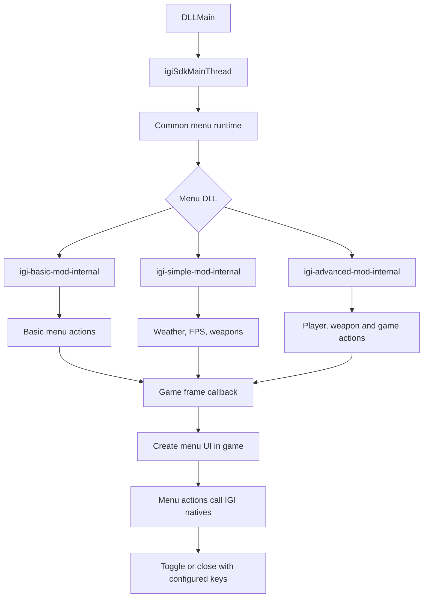

# Project IGI Mod Base

Project IGI Mod Base is a foundation for creating single-player mods and in-game mod menus It provides an in-game menu interface, game native bindings, runtime hooking and memory support, logging, and examples to build on.

## Included mod menus

### Heaven Mod Menu (Production Menu)

Heaven's Mod is the flagship gameplay menu for Project I.G.I., featuring 50 verified native-backed gameplay controls organized across seven categories: Weapons, Player, Camera, World, Vehicles, AI / NPC, and Live Target Selection.

- **Dual Frontend Architecture:**
  - **Internal Menu (`igi-heaven-mod-internal.dll`)**: Runs inside the retail engine via the QVM `MenuManager` UI. Outsized control sets automatically generate a scrollable `ListBox` over a flattened command list so every option stays accessible within the retail frame.
  - **External ImGui Menu (`igi-heaven-mod-external.dll`)**: Renders a rich Direct3D 7 Dear ImGui overlay with full mouse navigation, categories, and real-time readouts.
- **50+ Verified Controls:**
  - **Weapons**: Direct ammo refills for Glock 17, MP5SD, M16A2, and AK-47, all-weapon equips (including Binoculars and Medipack), weapon cycling, draw animations, and unlimited ammo.
  - **Player**: Health/damage reset, ground snap, controller flag toggles, team/state readouts, and collision toggles.
  - **Camera**: First/third-person camera toggling, weapon aiming angles, and native 3rd-person crosshair rendering via retail HUD sprites.
  - **World**: Frame-rate presets (30 to 240 FPS), precipitation weather control (Rain, Snow, Off), mission warp (Levels 1–14), and flow performance diagnostics.
  - **Vehicles**: Car driving controls (throttle/steering/brake), car reset, car explosion, and whole-level vehicle triggers (explode all cars, reset all cars).
  - **AI / NPC**: Soldier stand-down, AI weapon equipping, alarm action clearing, and live status readouts.
  - **Live Target Selection**: Tracks live NPCs, Cars/Tanks, and Helicopters by task ID (`Name [#taskId]`), refreshed dynamically from the running game's task table.

### Heaven Advanced Mod Menu

Built for advanced experimentation, fleet management, and spatial manipulation (`igi-heaven-mod-advanced-internal.dll` and `igi-heaven-mod-advanced-external.dll`):



#### Live NPC & AI Controls
- **Live NPC Target Selection**: Dynamically enumerates all active NPCs in the level with real-time task identifiers (e.g., `HumanSoldier_424 [#424]`).
- **Tactical Soldier Management**: Query status and parameters, equip weapons, reset damage, and toggle collision.
- **Behavioral Control**: Force soldier stand-down to reset alert states, or trigger instant execution via retail death state-machines.
- **3D Spatial Movement (Heaven Advanced)**: Move selected NPCs Forward (+5m), Backward (-5m), Left (-5m), Right (+5m), Elevate (+2m), and Snap to Ground.
- **Ground Attachment & Levitation**: Switch NPC and player between `Ground` (gravity-bound terrain probe) and `Air` (suspended levitation) via `Human_SnapToGround` and `Human_LeaveGround`.
- **Visible 3rd-Person Crosshair**: Centered crosshair reticle rendered natively through the retail HUD sprite pipeline.



#### Vehicle & Helicopter Fleet Controls
- **Live Ground Fleet Targeting**: Target active cars and tanks by task name and ID.
- **Interactive Driving**: Send throttle, steering, and braking commands directly into the retail car physics controller.
- **Vehicle Maintenance & Destruction**: Reset car positions and control inputs, or trigger vehicle explosions on demand.
- **Global Fleet Commands**: Execute level-wide `Explode All Cars` or `Reset All Cars` operations across all active vehicle tasks.
- **Live Helicopter Telemetry**: Select active helicopters (e.g., `Heli_866 [#866]`) to inspect mounted gun configs, door status, and state sizes.
- **Helicopter Engine Reset**: Restore selected helicopters back to initial insertion parameters using the retail `tick = 0` control branch.



#### World, Weather & Performance Controls
- **Instant Mission Warping**: Direct mission selection covering all 14 campaign levels (Level 1 Trainyard to Level 14 Headquarters) with proper menu resource cleanup.
- **Clean Mission Restart**: Instant mission restarts through the native engine reload flow.
- **Dynamic Weather System**: Switch between real-time Rain, Snow, or Off by parenting the retail `RainEffect` task and broadcasting parameter change events.
- **Decoupled Game Pause**: Toggle game freeze independently of menu visibility (`Running` / `Paused`).
- **High-Refresh Frame Limiter**: Switch between 30, 60, 120, 144, and 240 FPS presets for fluid gameplay on modern high-refresh monitors.
- **Real-Time Engine Telemetry**: Instant diagnostic readouts for Level Tick, Flow Counters (FPS, frames, renders), and internal Game Events.



### Simple Mod Menu

- Live rain, snow, or off selection and frame-rate selection (30, 60, or 120 FPS)
- Weapon list and pickup for Glock 17, MP5SD, UZI, M16A2, AK-47, Dragunov SVD, Minimi, and Spas 12
- First-person or third-person camera view
- Level selection for levels 1–14
- SFX volume, screen-flash clearing, and engine performance logging



### Advanced Mod Menu

- Everything in Simple Mod Menu
- Unlimited ammo
- Music volume control
- Player team/alive-state display
- Display refresh command

All controls run through the game-thread menu runtime. The mod menu pauses the
game while open and restores input when it closes.

### ImGui Advanced Menu (`feature/imgui-mod` branch)



This Direct3D 7/Dear ImGui implementation is hosted on the `feature/imgui-mod` branch.
It hooks the game's Direct3D 7 render pipeline via [AndenDev/D3D7Imgui](https://github.com/AndenDev/D3D7Imgui),
rendering a modern graphical overlay with interactive controls, theme selection, sliders,
combo boxes, and buttons alongside the retail game display.

Target: the `European` version Windows x86 IGI 1 executable. 
```sh
SHA256: dea34892d417715873ea61d7b2ba5556655f1ad65385104348146f9679915a01
MD5: 9d8ebb7f28a1be56a8626dd5948826e4
```
Native Windows is supported directly. On macOS and Linux, run the same Windows x86 game and DLL
through Wine using the included Wine scripts.

## How to Create a Mod Menu

The mod base provides two distinct menu architectures:
1. **Internal Mod Menu (develop & feature/imgui-mod branches)**: Uses Project I.G.I.'s native retail QVM `MenuManager` engine.
2. **External ImGui Mod Menu (feature/imgui-mod branch)**: Uses Dear ImGui hooked into Direct3D 7 via [AndenDev/D3D7Imgui](https://github.com/AndenDev/D3D7Imgui).

### 1. Creating an Internal Mod Menu (IGI Game Menu UI)

### Creating a new menu

The shared `src/mod_base/menu_host.cpp` calls these two functions:

```cpp
bool configureModMenu(igi::MenuConfig& config);
void runModMenu(const igi::MenuConfig& config,
                       igi::Runtime& runtime,
                       std::size_t item,
                       std::string_view value);
```

To create a new menu, implement both functions in your menu source file and
link that file with `src/mod_base/menu_host.cpp` and `src/platform/windows_dll.cpp`.

`configureModMenu()` defines the menu items and values for your mod. </br>
`runModMenu()` handles the selected item interact with game natives.

Your new menu should follow the same two-function pattern as
`demos/internal/simple-mod/simple_menu.cpp` or `demos/internal/basic-mod/basic_menu.cpp`.


```cpp
#include "config/menu_config.hpp"
#include "mod_base/menu_host.hpp"
#include "natives/mvp_natives.hpp"
#include "demos/internal/helpers/menu_helpers.hpp"

// 1. Define menu title, items, and initial choices
bool configureModMenu(igi::MenuConfig& config) {
    config.title = "My Custom Mod Menu";
    config.items = {
        {"godmode", igi::ModMenuItemKind::Action, "Unlimited Ammo", "", {}},
        {"weather", igi::ModMenuItemKind::List, "Weather", "", {"Off", "Rain", "Snow"}},
        {"fps", igi::ModMenuItemKind::List, "FPS Limit", "", {"30", "60", "120"}}
    };
    return true;
}

// 2. Handle player interaction (invoked when items are clicked or changed)
void runModMenu(const igi::MenuConfig& config,
                igi::Runtime& runtime,
                std::size_t item,
                std::string_view value) {
    if (item >= config.items.size()) return;
    const auto& id = config.items[item].id;

    if (id == "godmode") {
        IGI::PLAYER::SET_UNLIMITED_AMMO();
    } else if (id == "weather") {
        igi::setWeather(runtime, value);
    } else if (id == "fps") {
        igi::setFps(runtime, value);
    }
}
```

Link your menu source with `mod_base` and `src/platform/windows_dll.cpp`.
Existing examples:
- `demos/internal/basic-mod/basic_menu.cpp`
- `demos/internal/simple-mod/simple_menu.cpp`
- `demos/internal/advanced-mod/advanced_menu.cpp`

### 2. Creating an External ImGui Mod Menu (Dear ImGui Direct3D 7)

External menus (on branch `feature/imgui-mod`) use `src/mod_base/imgui_menu_host.cpp` and [AndenDev/D3D7Imgui](https://github.com/AndenDev/D3D7Imgui) to hook `IDirect3DDevice7::EndScene` and render Dear ImGui draw calls directly into the game's backbuffer.

External menus share the exact same configuration and action interface as internal menus (`configureModMenu` and `runModMenu`), making custom logic 100% portable between both UI backends:

```cpp
#include "config/menu_config.hpp"
#include "mod_base/menu_host.hpp"
#include "natives/mvp_natives.hpp"
#include "demos/internal/helpers/menu_helpers.hpp"

// 1. Define ImGui window title, options, and items (rendered via Dear ImGui D3D7)
bool configureModMenu(igi::MenuConfig& config) {
    config.title = "My Custom ImGui Mod Menu";
    // Optional ImGui overlay window configuration
    config.imgui.theme = "Dark";       // "Dark", "Light", or "Classic"
    config.imgui.fontSize = 16.0f;
    config.imgui.collapsible = true;

    // 3 Menu Options (rendered as buttons and combo dropdowns in Dear ImGui)
    config.items = {
        {"godmode", igi::ModMenuItemKind::Action, "Unlimited Ammo", "", {}},
        {"weather", igi::ModMenuItemKind::List, "Weather", "", {"Off", "Rain", "Snow"}},
        {"fps", igi::ModMenuItemKind::List, "FPS Limit", "", {"30", "60", "120"}}
    };
    return true;
}

// 2. Handle player interaction (invoked when ImGui buttons are clicked or combo items selected)
void runModMenu(const igi::MenuConfig& config,
                igi::Runtime& runtime,
                std::size_t item,
                std::string_view value) {
    if (item >= config.items.size()) return;
    const auto& id = config.items[item].id;

    if (id == "godmode") {
        IGI::PLAYER::SET_UNLIMITED_AMMO();
    } else if (id == "weather") {
        igi::setWeather(runtime, value);
    } else if (id == "fps") {
        igi::setFps(runtime, value);
    }
}
```

Link your menu source with `src/mod_base/imgui_menu_host.cpp`, `igi_imgui_dx7`, and `mod_base`.
Existing examples:
- `demos/external/basic-mod/basic_menu.cpp`
- `demos/external/simple-mod/simple_menu.cpp`
- `demos/external/advanced-mod/advanced_menu.cpp`

---

## How to Build a Mod Menu

All Win32 targets are cross-compiled using `tools/build-win32-dll.sh` (or Visual Studio / MSVC on native Windows). Build artifacts remain in the ignored `build-win32-*` directory; publish binaries only when creating a GitHub Release.

### 1. Building Internal Mod Menus

```sh

# Advanced Internal Menu -> build-win32-release/igi-advanced-mod-internal.dll
tools/build-win32-dll.sh --release --target igi_advanced_mod_menu
```

### 2. Building External ImGui Mod Menus (`feature/imgui-mod` branch)

```sh

# Advanced ImGui External Menu -> build-win32-release/igi-advanced-mod-external.dll
tools/build-win32-dll.sh --release --target igi_advanced_mod_menu_external
```

### 3. Building Injector & Helpers

```sh
# Injector CLI -> build-win32-release/IGI-Injector.exe
tools/build-win32-dll.sh --release --target igi_injector

# Virtual Keypress helper -> build-win32-release/IGI-Keypress.exe
tools/build-win32-dll.sh --release --target igi_keypress
```

Use `--debug` instead of `--release` to enable verbose console logging and trace logs.

---

## How to Run and Test a Mod Menu

### 1. Verification in Unicorn x86 Emulator

Before injecting into live game processes, verify DLL native signatures and ABI stability:

```sh
tools/build-win32-dll.sh --debug --target igi_advanced_mod_menu
python3 tools/igi_runtime_harness.py \
  --path demos/internal/advanced-mod/advanced_menu.cpp \
  --exe /path/to/igi.exe \
  --dll build-win32-debug/igi-advanced-mod-internal.dll
```

### 2. Running Live under Wine / Proton (macOS / Linux)

Set environment variables once:

```sh
export IGI_GAME_DIR=/path/to/IGI
export IGI_WINEPREFIX=~/.wine
export WINE_BIN=wine
cp config/project-igi-mod-config.ini "$IGI_GAME_DIR/project-igi-mod-config.ini"
```

Launch the game and auto-inject:

```sh
# Internal Menu
python3 tools/run_igi_wine.py level1 build-win32-release/igi-advanced-mod-internal.dll --attempts 10 --press-menu-key

# External ImGui Menu
python3 tools/run_igi_wine.py level1 build-win32-release/igi-advanced-mod-external.dll --attempts 10 --press-menu-key
```

### 3. Running Natively on Windows

1. Copy `config/project-igi-mod-config.ini` into your game directory next to `igi.exe`.
2. Start `igi.exe`.
3. Use `IGI-Injector.exe` to inject the DLL into the running `igi.exe` process:
```sh
binaries\IGI-Injector.exe <PID> igi-advanced-mod-internal.dll
```

**In-Game Controls:**
- Press **F5** (default `start_key`) to display and navigate the in-game native menu.
- The game pauses automatically while the menu is active.
- Press **F12** (default `end_key`) to safely unhook and detach the menu host.


## Verification

Before injecting a mod menu, run the Unicorn x86 emulator with the source and
the exact DLL you built:

```sh
IGI_RE_ROOT=/path/to/IGI-RE python3 tools/igi_runtime_harness.py --path demos/internal/simple-mod/simple_menu.cpp --exe /path/to/igi.exe --dll build-win32-debug/igi-simple-mod-internal.dll
```

The scan maps `IGI::DOMAIN::NAME` calls to their declared native signatures and
retail addresses, then executes supported calls in synthetic emulator state.


```sh
tools/verify_igi_re_hook_source.sh /path/to/IGI-RE
tools/verify_igi_hook.sh /path/to/igi.exe
```

The first validates the local registration evidence; the second checks
the supported executable hash, hook prologues, calling convention metadata and
task-table references. The injected DLL repeats the two hook-prologue checks in
memory and does not run CryptoAPI file hashing inside Wine. `python3 tools/build_inject_mod.py --attempts N` builds,
launches the game under Wine, injects the DLL, presses the configured keys and
reports whether the menu attached.

## Menu execution flow

All three menu DLLs start through the same Windows entry point. They then select
their own menu implementation.



`igiSdkMainThread` handles configuration, hotkeys and shutdown. The shared
runtime creates the visible UI from the game frame callback; each DLL only
provides its own menu items and actions.


## License and credits

Read [`CREDITS.md`](CREDITS.md), [`NOTICE`](NOTICE) and `LICENSES/` before
redistributing. Metadata is attributed and kept as address/signature
research only.
- SlickDaddy and BlankName — Project I.G.I. native research and information
- Cukier for ImGUI DirectX 7 Wrapper project ([https://github.com/AndenDev/D3D7Imgui](https://github.com/AndenDev/D3D7Imgui))
- Artiom — QVM tools and compiler work
- Inspired by BigBase V2 from GTA V modding community [https://github.com/BigBase/BigBase-V2](https://github.com/BigBase/BigBase-V2)
