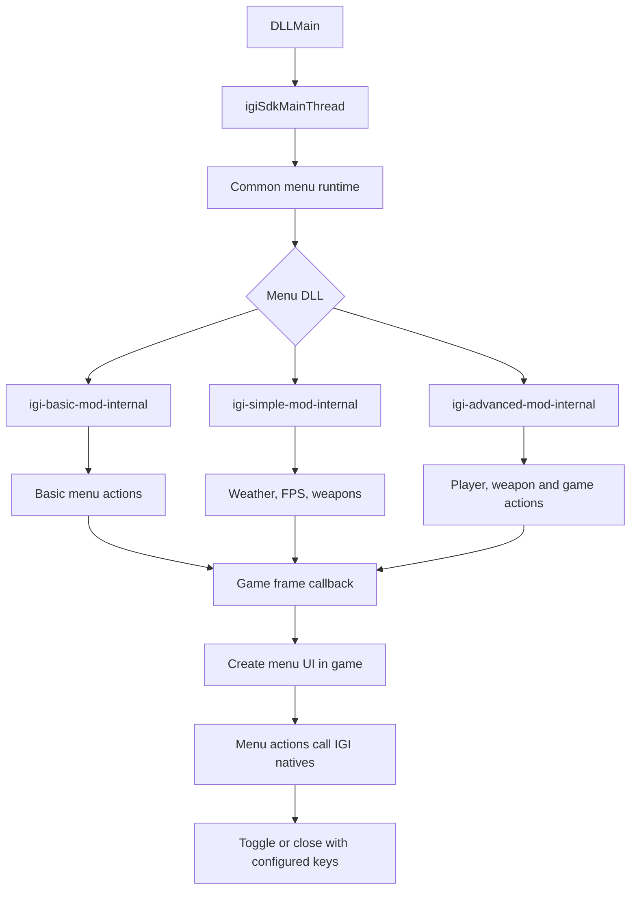

# Project IGI Mod Base

Version: 0.2

Project IGI Mod Base is a C++ foundation for creating single-player mods and in-game mod menus for Project I.G.I. It provides an in-game menu interface, game native bindings, runtime hooking and memory support, logging, and examples to build on.

## Branch Architecture

- **`develop`**: Dedicated strictly to the **IGI Game Menu UI (Internal Mod Menu)** rendered through Project I.G.I.'s retail QVM script and `MenuManager` lifecycle.
- **`feature/imgui-mod`**: Dedicated to **Dear ImGui (External Mod Menu)** rendered through a Direct3D 7 overlay hook using [AndenDev/D3D7Imgui](https://github.com/AndenDev/D3D7Imgui).

## Prebuilt Binaries

Ready-to-inject Windows x86 DLLs are provided in [`binaries/`](binaries/):

- [`binaries/igi-advanced-mod-internal.dll`](binaries/igi-advanced-mod-internal.dll): In-game native mod menu (QVM MenuManager).
- [`binaries/igi-advanced-mod-external.dll`](binaries/igi-advanced-mod-external.dll): Modern Dear ImGui overlay mod menu (Direct3D 7 via `D3D7Imgui`).

## Version 0.2: Restructure and ImGui Integration

- Reorganized the implementation into focused `src/` modules for configuration,
  logging, native bindings, runtime hooks, platform hosting, UI, and the shared
  mod-menu host.
- Replaced the old SDK include layout with a smaller public mod base and kept
  menu-specific actions inside `demos/internal/` and `demos/external/`.
- Added Basic, Simple, and Advanced internal menu targets that share one
  game-thread host and typed native helpers.
- Added Dear ImGui Direct3D 7 renderer backend integration from
  [AndenDev/D3D7Imgui](https://github.com/AndenDev/D3D7Imgui) on `feature/imgui-mod`.
- Added formatting, clang-tidy, CTest, and Unicorn verification to the local
  workflow and GitHub Actions.
- Fixed visible weather by parenting the retail `RainEffect` task under the active
  `Level` task and broadcasting `Param_GetChangedEvent`.
- Fixed level switching to use the game’s Flow request and `Game` cleanup path,
  releasing injected QVM resources before the new level attaches.
- Made the configured end key safely stop the resident menu host, preventing
  the start key from reopening it until `igi.exe` exits.
- Added prebuilt release DLLs in `binaries/` with automated build-output copying.

## Included mod menus


### Simple Mod Menu

- Live rain, snow, or off selection and frame-rate selection (30, 60, or 120 FPS)
- Weapon list and pickup for Glock 17, MP5SD, UZI, M16A2, AK-47, Dragunov SVD, Minimi, and Spas 12
- First-person or third-person camera view
- Level selection for levels 1–14
- SFX volume, screen-flash clearing, and engine performance logging


### Advanced Mod Menu

- Everything in Simple Mod Menu
- Unlimited ammo
- Music volume control
- Player team/alive-state display
- Display refresh command

All controls run through the game-thread menu runtime. The mod menu pauses the
game while open and restores input when it closes.

### External ImGui Advanced Menu (`feature/imgui-mod` branch)


This Direct3D 7/Dear ImGui implementation is hosted on the `feature/imgui-mod` branch.
It hooks the game's Direct3D 7 render pipeline via [AndenDev/D3D7Imgui](https://github.com/AndenDev/D3D7Imgui),
rendering a modern graphical overlay with interactive controls, theme selection, sliders,
combo boxes, and buttons alongside the retail game display.

Target: the EU/Chinese Windows x86 IGI 1 executable. Native Windows is
supported directly. On macOS and Linux, run the same Windows x86 game and DLL
through Wine using the included Wine scripts.
Out of scope: multiplayer, trainers, memory editors, process scanners.

## Requirements

- CMake 3.20+
- A 32-bit mingw-w64 toolchain (`i686-w64-mingw32-g++`), or a 32-bit MSVC toolset
- Python 3 (used to regenerate the hash table at build time)

The `data/` directory is local-only and ignored by Git. Builds use the checked-in native bindings when it is absent; regenerating bindings and running catalogue comparison tests requires the local IGI data files.

## Build

Everything is built by `tools/build-win32-dll.sh`. It sets the C, C++ and RC
cross-compilers explicitly and discards any stale build tree that still points
at a host compiler.

## C++ style and linting

Format all first-party C++ under `src/` and `demos/`:

```sh
python3 tools/format_cpp.py
python3 tools/format_cpp.py --check
```

Configure once with a compilation database, then run the static analyzer:

```sh
cmake -S . -B build-macos-verify -DCMAKE_EXPORT_COMPILE_COMMANDS=ON
cmake --build build-macos-verify --target lint_cpp format_cpp_check
```

GitHub Actions runs both checks on every pushed commit and pull request.

### Internal menu

```sh
# The mod menu DLL (default target)
tools/build-win32-dll.sh --release

# The injector and the keypress helper
tools/build-win32-dll.sh --release --target igi_injector
tools/build-win32-dll.sh --release --target igi_keypress
```

Build the simple menu demo:

```sh
tools/build-win32-dll.sh --debug --target igi_simple_mod_menu
```

Outputs land in `build-win32-release/` (`build-win32-debug/` with `--debug`):

| Artifact                       | Role                                                |
| ------------------------------ | --------------------------------------------------- |
| `igi-basic-mod-internal.dll` | The mod menu                                        |
| `IGI-Injector.exe`            | Loads the DLL into a running `igi.exe`              |
| `IGI-Keypress.exe`            | Sends keys to the Wine/Windows desktop during tests |

Debug builds allocate a console; Release builds log to file only.

## Natives

All wrappers live in `src/natives/mvp_natives.hpp` and use the
upstream `IGI::DOMAIN::NAME` style. Include the umbrella header and call them:

```cpp
#include "natives/mvp_natives.hpp"

const char weatherOn[] = {'r', 1, '\0'};
IGI::GAME::SET_RAINING(weatherOn);      // verified flag: weather[1] is 0 or 1
IGI::MISC::FRAMES_SET(30);             // frame limit
IGI::PLAYER::SET_UNLIMITED_AMMO();     // player
IGI::AUDIO::MUSIC_SET_VOLUME(0.5f, 1.0f);
IGI::GAME::SET_DISPLAY_MODE();

const bool paused = IGI::GAME::IS_PAUSED() != 0;
const auto event0 = IGI::GAME::GET_EVENT0();
void* world       = IGI::GAME::GET_WORLD();
```

Void natives are queued onto the game thread. Value-returning natives must be
called from the game thread, otherwise they log a warning and return zero.
The full symbol table is also available as `IGI::HASH::<Name>` constants.

## Menu helpers

[`demos/internal/helpers/menu_helpers.hpp`](demos/internal/helpers/menu_helpers.hpp)
contains optional wrappers for menu actions that need more than one native or
need consistent menu-side behavior, such as weather, frame rate, level loading,
and menu commands. Use these helpers when a menu needs one of those actions;
otherwise call typed `IGI::` natives directly. Add or extend a helper only when
the action is shared or requires a verified native call chain.

`requireLiveGameThread(runtime)` is the common guard for immediate in-level
actions. `refreshLiveMenu(runtime, effect)` uses the verified
`MenuManager_Refresh` native after an action, so the active menu redraws
without restarting the level. Weather, weapon pickup, player actions, audio,
and other verified native calls take effect on the next game frame and do not
reload a level. Level loading is intentionally separate: it detaches the
injected menu before the game destroys the old level. AI or building
creation/removal needs a verified object-specific native lifecycle; do not use
raw task memory or a generic task deletion helper for it.

`GAME::SET_RAINING` only changes the game's `gRaining` state. Visible
precipitation belongs to the level's `RainEffect` task. `setWeather()` follows
the retail level-QVM lifecycle: it creates `RainEffect` through `Task_New`,
tracks the injected task by an unused level ID, and deletes only that task when
Weather is set to Off or the level changes. Its `Is Rain` parameter selects
rain (`TRUE`) or snow (`FALSE`); only one injected precipitation effect exists
at a time.

## Config

`project-igi-mod-config.ini` sits beside `igi.exe` and is read on startup.

```ini
[mod_menu]
enabled=true
start_key=F3              ; opens the menu and toggles it closed again
end_key=F12               ; closes the menu and unloads the SDK
native_mode=hooked        ; required for internal menus
screen_id=990
x=95
y=185
width=755
height=500
hook=display_add_frame_callback
log_level=debug           ; trace|debug|info|warning|error|critical
log_file=project-igi-mod.log
console=true
```

`start_key` and `end_key` accept `F3`–`F12`, `Home`, `End`, `PageUp`,
`PageDown`, `Insert` and `Delete`. The DLL, the injector and the scripts all
read these keys from this file; nothing hardcodes a hotkey.

The end key safely closes the menu, stops its hooks and stops the resident DLL
host thread. The DLL stays mapped until `igi.exe` exits to avoid calling
unloaded code, and the start key is disabled for the remainder of that process.

Each menu DLL owns its items in C++; `[mod_menu.items]` is not read.
Set `log_file` under `[mod_menu]` to a filename beside `igi.exe`; both Debug and Release builds use it. Directory paths are not accepted.

## How to Create a Mod Menu

The mod base provides two distinct menu architectures:
1. **Internal Mod Menu (develop & feature/imgui-mod branches)**: Uses Project I.G.I.'s native retail QVM `MenuManager` engine.
2. **External ImGui Mod Menu (feature/imgui-mod branch)**: Uses Dear ImGui hooked into Direct3D 7 via [AndenDev/D3D7Imgui](https://github.com/AndenDev/D3D7Imgui).

### 1. Creating an Internal Mod Menu (IGI Game Menu UI)

Internal menus are hosted by `src/mod_base/menu_host.cpp`. Each menu implements two functions:

```cpp
#include "config/menu_config.hpp"
#include "mod_base/menu_host.hpp"
#include "natives/mvp_natives.hpp"

// 1. Define menu title, items, and initial choices
bool configureModMenu(igi::MenuConfig& config) {
    config.title = "My Custom Mod Menu";
    config.items = {
        {"godmode", igi::ModMenuItemKind::Action, "Unlimited Ammo", "", {}},
        {"weather", igi::ModMenuItemKind::List, "Weather", "", {"Off", "Rain", "Snow"}},
        {"fps", igi::ModMenuItemKind::List, "FPS Limit", "", {"30", "60", "120"}}
    };
    return true;
}

// 2. Handle player interaction (invoked when items are clicked or changed)
void runModMenu(const igi::MenuConfig& config,
                igi::Runtime& runtime,
                std::size_t item,
                std::string_view value) {
    if (item >= config.items.size()) return;
    const auto& id = config.items[item].id;

    if (id == "godmode") {
        IGI::PLAYER::SET_UNLIMITED_AMMO();
    } else if (id == "weather") {
        igi::setWeather(runtime, value);
    } else if (id == "fps") {
        igi::setFps(runtime, value);
    }
}
```

Link your menu source with `mod_base` and `src/platform/windows_dll.cpp`.
Existing examples:
- `demos/internal/basic-mod/basic_menu.cpp`
- `demos/internal/simple-mod/simple_menu.cpp`
- `demos/internal/advanced-mod/advanced_menu.cpp`

### 2. Creating an External ImGui Mod Menu (Dear ImGui Direct3D 7)

External menus (on branch `feature/imgui-mod`) use `src/mod_base/imgui_menu_host.cpp` and [AndenDev/D3D7Imgui](https://github.com/AndenDev/D3D7Imgui) to hook `IDirect3DDevice7::EndScene` and render Dear ImGui draw calls directly into the game's backbuffer.

External menus share the exact same configuration and action interface as internal menus (`configureModMenu` and `runModMenu`), making custom logic 100% portable between both UI backends:

```cpp
#include "config/menu_config.hpp"
#include "mod_base/menu_host.hpp"

bool configureBasicMenu(igi::MenuConfig &config);
void basicMenuAction(const igi::MenuConfig &config, igi::Runtime &runtime, std::size_t item, std::string_view value);

bool configureModMenu(igi::MenuConfig &config) {
    return configureBasicMenu(config);
}

void runModMenu(const igi::MenuConfig &config, igi::Runtime &runtime, std::size_t item, std::string_view value) {
    basicMenuAction(config, runtime, item, value);
}
```

Link your menu source with `src/mod_base/imgui_menu_host.cpp`, `igi_imgui_dx7`, and `mod_base`.
Existing examples:
- `demos/external/basic-mod/basic_menu.cpp`
- `demos/external/simple-mod/simple_menu.cpp`
- `demos/external/advanced-mod/advanced_menu.cpp`

---

## How to Build a Mod Menu

All Win32 targets are cross-compiled using `tools/build-win32-dll.sh` (or Visual Studio / MSVC on native Windows). Successful builds automatically copy artifacts to the [`binaries/`](binaries/) directory.

### 1. Building Internal Mod Menus

```sh
# Basic Internal Menu -> binaries/igi-basic-mod-internal.dll
tools/build-win32-dll.sh --release --target igi_basic_mod_menu

# Simple Internal Menu -> binaries/igi-simple-mod-internal.dll
tools/build-win32-dll.sh --release --target igi_simple_mod_menu

# Advanced Internal Menu -> binaries/igi-advanced-mod-internal.dll
tools/build-win32-dll.sh --release --target igi_advanced_mod_menu
```

### 2. Building External ImGui Mod Menus (`feature/imgui-mod` branch)

```sh
# Basic ImGui External Menu -> binaries/igi-basic-mod-external.dll
tools/build-win32-dll.sh --release --target igi_basic_mod_menu_external

# Simple ImGui External Menu -> binaries/igi-simple-mod-external.dll
tools/build-win32-dll.sh --release --target igi_simple_mod_menu_external

# Advanced ImGui External Menu -> binaries/igi-advanced-mod-external.dll
tools/build-win32-dll.sh --release --target igi_advanced_mod_menu_external
```

### 3. Building Injector & Helpers

```sh
# Injector CLI -> binaries/IGI-Injector.exe
tools/build-win32-dll.sh --release --target igi_injector

# Virtual Keypress helper -> binaries/IGI-Keypress.exe
tools/build-win32-dll.sh --release --target igi_keypress
```

Use `--debug` instead of `--release` to enable verbose console logging and trace logs.

---

## How to Run and Test a Mod Menu

### 1. Verification in Unicorn x86 Emulator

Before injecting into live game processes, verify DLL native signatures and ABI stability:

```sh
tools/build-win32-dll.sh --debug --target igi_advanced_mod_menu
python3 tools/igi_runtime_harness.py \
  --path demos/internal/advanced-mod/advanced_menu.cpp \
  --exe /path/to/igi.exe \
  --dll build-win32-debug/igi-advanced-mod-internal.dll
```

### 2. Running Live under Wine / Proton (macOS / Linux)

Set environment variables once:

```sh
export IGI_GAME_DIR=/path/to/IGI
export IGI_WINEPREFIX=~/.wine
export WINE_BIN=wine
cp config/project-igi-mod-config.ini "$IGI_GAME_DIR/project-igi-mod-config.ini"
```

Launch the game and auto-inject:

```sh
# Internal Menu
python3 tools/run_igi_wine.py level1 binaries/igi-advanced-mod-internal.dll --attempts 10 --press-menu-key

# External ImGui Menu
python3 tools/run_igi_wine.py level1 binaries/igi-advanced-mod-external.dll --attempts 10 --press-menu-key
```

### 3. Running Natively on Windows

1. Copy `config/project-igi-mod-config.ini` into your game directory next to `igi.exe`.
2. Start `igi.exe`.
3. Proceed to the injection steps below.

---

## How to Inject a Mod Menu

### 1. Injecting Internal Mod Menus

Use `IGI-Injector.exe` to inject the DLL into the running `igi.exe` process:

```cmd
:: Find PID with tasklist:
tasklist /FI "IMAGENAME eq igi.exe"

:: Inject internal mod menu:
binaries\IGI-Injector.exe <PID> binaries\igi-advanced-mod-internal.dll
```

**In-Game Controls:**
- Press **F5** (default `start_key`) to display and navigate the in-game native menu.
- The game pauses automatically while the menu is active.
- Press **F12** (default `end_key`) to safely unhook and detach the menu host.

### 2. Injecting External ImGui Mod Menus

```cmd
:: Inject external ImGui mod menu:
binaries\IGI-Injector.exe <PID> binaries\igi-advanced-mod-external.dll
```

**In-Game Controls:**
- Press **F5** (default `start_key`) to toggle the Dear ImGui window overlay on/off.
- The overlay features an interactive mouse cursor, draggable window, tabs, combo boxes, and sliders.
- Customize theme, alpha, scale, and window settings in `[imgui]` section of `project-igi-mod-config.ini`.
- Press **F12** (default `end_key`) to shut down the ImGui renderer and restore original D3D7 states.

### 3. Wine CLI Injection Helper

For an already running game under Wine without restarting:

```sh
# Internal menu
WINEPREFIX="$IGI_WINEPREFIX" tools/wine_igi_inject.sh binaries/igi-advanced-mod-internal.dll igi.exe

# External ImGui menu
WINEPREFIX="$IGI_WINEPREFIX" tools/wine_igi_inject.sh binaries/igi-advanced-mod-external.dll igi.exe
```

## Verification

Before injecting a mod menu, run the Unicorn x86 emulator with the source and
the exact DLL you built:

```sh
IGI_RE_ROOT=/path/to/IGI-RE python3 tools/igi_runtime_harness.py --path demos/internal/simple-mod/simple_menu.cpp --exe /path/to/igi.exe --dll build-win32-debug/igi-simple-mod-internal.dll
```

The scan maps `IGI::DOMAIN::NAME` calls to their declared native signatures and
retail addresses, then executes supported calls in synthetic emulator state.
Pickup uses an initialized player fixture with the weapon creation and sound
calls stubbed and checked. `DEFER` means a call needs live game state and was
not executed. Raw address calls are not found by the scanner. A passing scan
does not prove DLL initialization, menu rendering, actual game effects, or
that every signature is correct; test those in a running game as well.

```sh
tools/verify_igi_re_hook_source.sh /path/to/IGI-RE
tools/verify_igi_hook.sh /path/to/igi.exe
```

The first validates the local registration evidence; the second checks
the supported executable hash, hook prologues, calling convention metadata and
task-table references. The injected DLL repeats the two hook-prologue checks in
memory and does not run CryptoAPI file hashing inside Wine. `python3 tools/build_inject_mod.py --attempts N` builds,
launches the game under Wine, injects the DLL, presses the configured keys and
reports whether the menu attached.

## Menu execution flow

All three menu DLLs start through the same Windows entry point. They then select
their own menu implementation.



`igiSdkMainThread` handles configuration, hotkeys and shutdown. The shared
runtime creates the visible UI from the game frame callback; each DLL only
provides its own menu items and actions.

### Creating a new menu

The shared `src/mod_base/menu_host.cpp` calls these two functions:

```cpp
bool configureModMenu(igi::MenuConfig& config);
void runModMenu(const igi::MenuConfig& config,
                       igi::Runtime& runtime,
                       std::size_t item,
                       std::string_view value);
```

To create a new menu, implement both functions in your menu source file and
link that file with `src/mod_base/menu_host.cpp` and `src/platform/windows_dll.cpp`.

`configureModMenu()` defines the menu items and values. The shared runtime
calls it during `IGI_MenuManager_Internal_Initialize()`.

`runModMenu()` handles the selected item. The shared
`MenuScriptBridge` calls it whenever the player changes a menu value or invokes
an action.

The existing implementations are:

```text
igi-basic-mod-internal    → basic_menu.cpp    → basicMenuAction
igi-simple-mod-internal   → simple_menu.cpp   → simpleMenuAction
igi-advanced-mod-internal → advanced_menu.cpp → simple and advanced actions
```

Your new menu should follow the same two-function pattern as
`demos/internal/simple-mod/simple_menu.cpp` or `demos/internal/basic-mod/basic_menu.cpp`.

## License and credits

Read [`CREDITS.md`](CREDITS.md), [`NOTICE`](NOTICE) and `LICENSES/` before
redistributing. Metadata is attributed and kept as address/signature
research only.

- SlickDaddy and BlanknameEs — Project I.G.I. native research and information
- Artiom — QVM tools and compiler work
